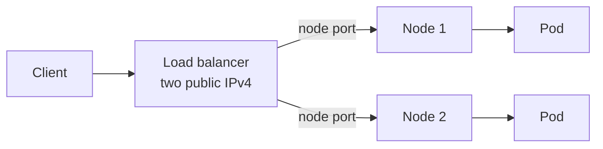

A Kubernetes Service of type `LoadBalancer` exposes your workloads to the internet. On Clever Kubernetes Engine (CKE), the cloud controller manager of your cluster gives each of these Services a dedicated layer 4 load balancer, with two public IPv4 addresses. It keeps this load balancer in sync with the Service, its ports, and the nodes of the cluster.

This page explains how these load balancers route traffic, and how to configure them with annotations on the Service. The [Kubernetes page](/doc/deploy/kubernetes/#deployment-with-a-load-balancer-service) shows a first deployment, and the [quotas](/doc/deploy/kubernetes/#quotas-and-limits) that apply to load balancers.

## How a load balancer routes traffic

The load balancer opens one listener for each port of the Service, with the protocol of this port. A Service can mix TCP and UDP ports. Each listener sends the traffic to every node of the cluster, on the node port of the Service port. The nodes then deliver it to the pods.



The datagrams of a UDP flow, from the same client address and port, stay on the same node. When a node joins or leaves the cluster, the controller adds or removes it in place. The listeners stay up, and the connections and flows to the other nodes go on.

Once the load balancer is ready, its addresses appear in the `EXTERNAL-IP` column of `kubectl get service`. The controller also writes its domain name in the `clever-cloud.com/load-balancer-domain` annotation of the Service, which you can target with a `CNAME` record:

```bash
kubectl get service nginx-service \
  -o jsonpath='{.metadata.annotations.clever-cloud\.com/load-balancer-domain}'
```

The controller records the load balancer in the `clever-cloud.com/load-balancer-id` and `clever-cloud.com/load-balancer-domain` annotations. Don't edit or remove them: the controller uses them to find the load balancer again, and to delete it with the Service.

## Annotations

Annotations on the Service configure its load balancer:

| Annotation | Values | Read |
| --- | --- | --- |
| `clever-cloud.com/load-balancer-flavor` | `XS-duo`, `XS-quattro`, `S-duo`, `S-quattro`, `M-quattro`, `M-octo`, `L-octo` | At creation |
| `clever-cloud.com/load-balancer-proxy-protocol` | `true`, `tcp`, `udp`, `false` | On every change |
| `clever-cloud.com/load-balancer-proxy-protocol-every-datagram` | `true`, `false` | On every change |
| `clever-cloud.com/load-balancer-udp-health-check-port` | Name or number of a TCP port of the Service | On every change |

The controller reads the flavor once, when it creates the load balancer. It applies the other annotations to the running load balancer each time you set, change, or remove them, without interrupting its listeners.

Values are case-insensitive, except port names. A value the controller can't read, an empty one included, fails the Service with an event, and leaves the load balancer unchanged: see [Troubleshoot a load balancer](#troubleshoot-a-load-balancer). To get the default of an annotation, remove it rather than leaving it empty.

## Choose the size of the load balancer

The `clever-cloud.com/load-balancer-flavor` annotation sets the size of the load balancer. Without it, the load balancer gets `XS-duo`, the smallest flavor:

```yaml {filename="service.yaml",hl_lines=[6]}
apiVersion: v1
kind: Service
metadata:
  name: nginx-service
  annotations:
    clever-cloud.com/load-balancer-flavor: M-octo
spec:
  type: LoadBalancer
  selector:
    app: nginx
  ports:
    - protocol: TCP
      port: 80
      targetPort: 80
```

The controller reads the flavor only when it creates the load balancer: changing the annotation afterwards doesn't resize it. To change the size, delete and recreate the Service, which also changes its public addresses. The load balancers of an organisation share its [quota](/doc/deploy/kubernetes/#quotas-and-limits), so a large flavor reduces what the other Services can get.

## Send traffic only to the nodes running a pod

By default, a Service uses the `Cluster` external traffic policy. Every node accepts the traffic, and forwards it to a ready pod, which can run on another node. This spreads the load evenly across the pods, at the cost of an extra hop.

With `externalTrafficPolicy: Local`, a node only delivers the traffic to the pods it runs, and drops it when it runs none. Kubernetes then allocates a health check port to the Service, on which each node reports whether it runs a ready pod. The controller configures the load balancer to probe it, so that the traffic only reaches the nodes running a ready pod:

```yaml {filename="service.yaml",hl_lines=[9]}
apiVersion: v1
kind: Service
metadata:
  name: nginx-service
spec:
  type: LoadBalancer
  selector:
    app: nginx
  externalTrafficPolicy: Local
  ports:
    - protocol: TCP
      port: 80
      targetPort: 80
```

The load balancer probes each node every 5 seconds, with a timeout of 2 seconds. A node leaves the rotation after 2 failed probes, about 10 seconds after its last pod stops being ready. It comes back after 2 successful ones. When the last ready pod of a node starts terminating, the node fails the probe right away. The load balancer then stops sending it new connections, while the pod finishes the current ones.

This probe covers the TCP ports of the Service. For its UDP ports, add a [UDP health check](#check-the-health-of-udp-ports).

## Check the health of UDP ports

The load balancer can't probe a UDP port by itself. Your pods may serve a TCP port next to their UDP ports, as WebRTC servers often do. Set the `clever-cloud.com/load-balancer-udp-health-check-port` annotation to the name or the number of this TCP port, and the load balancer probes every UDP port of the Service through it:

```yaml {filename="service.yaml",hl_lines=[6]}
apiVersion: v1
kind: Service
metadata:
  name: livekit
  annotations:
    clever-cloud.com/load-balancer-udp-health-check-port: rtc-tcp
spec:
  type: LoadBalancer
  selector:
    app: livekit
  externalTrafficPolicy: Local
  ports:
    - name: rtc-tcp
      protocol: TCP
      port: 7881
    - name: rtc-udp
      protocol: UDP
      port: 7882
```

The probe opens a TCP connection to the node port of the named port, on each node, with the timings of the `Local` probe. The nodes forward this connection to a ready pod of the Service, so the probe follows the external traffic policy:

- With `Local`, only the nodes running a ready pod accept it, and receive UDP traffic
- With `Cluster`, every live node accepts it while a ready pod listens on the TCP port

The TCP port stands for the UDP ports, so the probe suits pods that serve both protocols from the same process. A pod whose UDP side fails while its TCP side still accepts connections keeps receiving UDP traffic. The probe only steers new flows: a UDP flow already established with a node stays on it until it goes idle. When every node fails the probe, the load balancer still sends the traffic to all of them, rather than dropping it.

A terminating pod keeps accepting connections on its TCP port until it stops listening, so its node keeps receiving new UDP flows until then. After that, the node drops these new flows until it fails 2 probes. To keep this delay short, make your pods stop listening on the TCP port when they start terminating.

All the UDP ports of a Service share the same TCP port. To probe UDP ports through different TCP ports, expose them with separate Services. The annotation must name a TCP port of the same Service that has a node port: any other value fails the Service.

## Get the client address with the PROXY protocol

The load balancer opens its own connections to the nodes, so your pods see its address, not the address of the client. To give them the address of the client, enable the [PROXY protocol](https://www.haproxy.org/download/3.2/doc/proxy-protocol.txt) with the `clever-cloud.com/load-balancer-proxy-protocol` annotation. The load balancer then writes a PROXY protocol version 2 header in front of the traffic it sends:

| Value | TCP ports | UDP ports |
| --- | --- | --- |
| `false`, or no annotation | No header | No header |
| `tcp` | Header | No header |
| `true` | Header | Header |
| `udp` | No header | Header |

On a TCP port, the header starts each connection. On a UDP port, it precedes the first datagram of each flow. Set `clever-cloud.com/load-balancer-proxy-protocol-every-datagram` to `true` to put it in front of every datagram instead, as some UDP servers expect. This annotation applies to the UDP ports that get the header: setting it to `true` while the UDP ports get none fails the Service.

```yaml {filename="service.yaml",hl_lines=[6]}
apiVersion: v1
kind: Service
metadata:
  name: nginx-service
  annotations:
    clever-cloud.com/load-balancer-proxy-protocol: "true"
spec:
  type: LoadBalancer
  selector:
    app: nginx
  ports:
    - protocol: TCP
      port: 80
      targetPort: 80
```

Your application must expect the header on every port that receives it, or it reads the header as data and fails. For example, NGINX reads it with the `proxy_protocol` parameter of its [`listen` directive](https://nginx.org/en/docs/http/ngx_http_core_module.html#listen), and takes the client address from it with the [real IP module](https://nginx.org/en/docs/http/ngx_http_realip_module.html#real_ip_header):

```nginx {filename="default.conf"}
server {
    listen 80 proxy_protocol;
    set_real_ip_from 0.0.0.0/0;
    real_ip_header proxy_protocol;
}
```

`set_real_ip_from 0.0.0.0/0` trusts the header from any client: keep it only when NGINX is reachable through the load balancer alone.

On a Service mixing TCP and UDP, use `tcp` or `udp` to send the header only to the ports whose application reads it. Many media servers, for example, don't read it on their UDP ports.

While the header is on, the status of the Service sets `ipMode: Proxy`. Pods that reach the public address of the load balancer then go through the load balancer, and get the header too. This applies to all the ports of the Service. The health checks of the load balancer never carry the header.

## Troubleshoot a load balancer

The controller never publishes an address it doesn't have: a Service keeps `<pending>` in its `EXTERNAL-IP` column until its load balancer has a usable address. To find the reason, describe the Service and look for a `SyncLoadBalancerFailed` event:

```bash
kubectl describe service nginx-service
```

The controller retries with a growing delay, between 5 seconds and 5 minutes, so a transient failure clears up by itself. These causes need an action:

- **An annotation it can't read**: the event names the annotation and the accepted values. Fix or remove the annotation
- **The quota of the organisation**: an error 507 means the organisation has no load balancer left. See [Quotas and limits](/doc/deploy/kubernetes/#quotas-and-limits)
- **A `clever-cloud.com/load-balancer-id` annotation that names a deleted load balancer**: remove the annotation, and the controller creates a new load balancer
