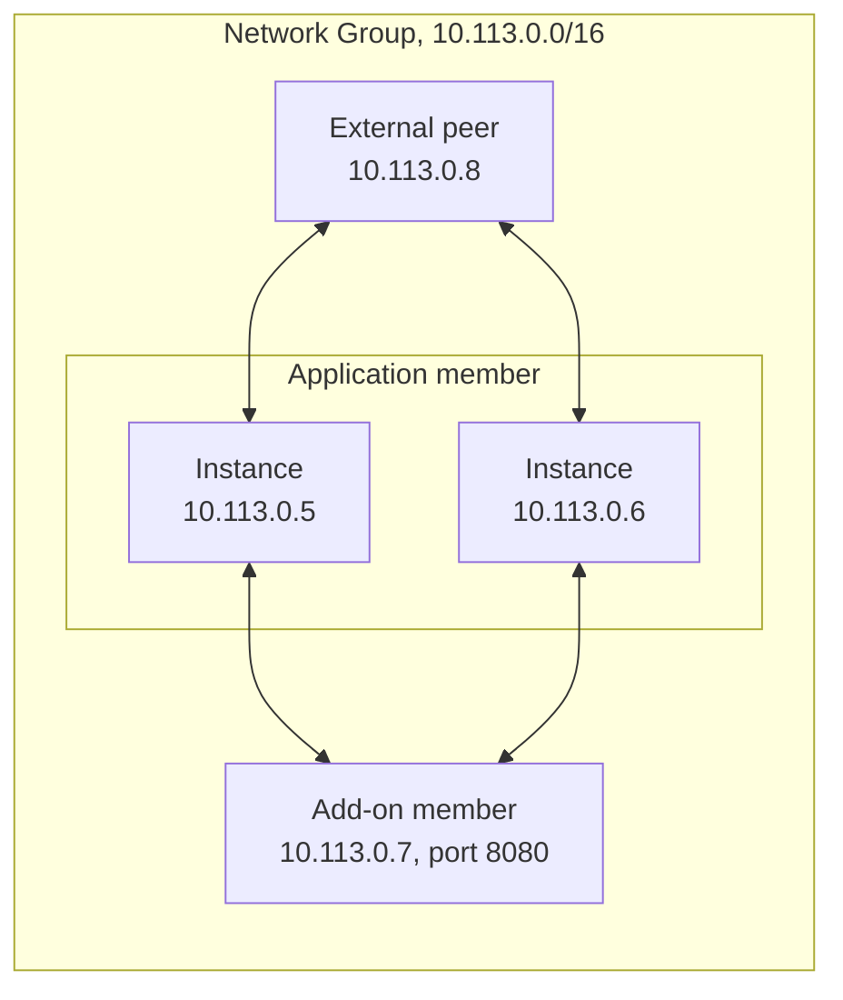

A Network Group is a private network between the resources of an organisation, built with [WireGuard](https://www.wireguard.com/). It links Clever Cloud applications, dedicated add-ons, and external machines, such as a server or a laptop. They reach each other through encrypted tunnels on any port, with either an internal domain name or a private IP address.

A Network Group adds a private path: your applications keep their public domains, and your add-ons their public addresses. To join the instances of an application to a network managed by Tailscale instead, see [Tailscale](/doc/manage/tailscale/).

Manage Network Groups from the [Console](https://console.clever-cloud.com), in the **Network Groups** menu of your organisation, or with [Clever Tools](/doc/tools/cli/network-groups/). Its `ng` command is experimental: enable it with `clever features enable ng`.

## How it works

A Network Group has members: applications, add-ons, and external machines of the same organisation. Each running instance of a member is a peer: an application scaled to three instances brings three peers. A peer gets a private address from the range of the group, of the form `10.x.0.0/16`, and a new instance gets a new address.

On each instance, Clever Cloud adds one WireGuard interface for each group the application belongs to, named `wg-` followed by the end of the group ID. The peers connect directly to each other, without a central gateway.

An application or add-on member has a domain name for all its peers, and each peer its own name, from the ID of the instance:

| Name                                          | Resolves to                     |
| --------------------------------------------- | ------------------------------- |
| `<memberID>.m.<ngID>.cc-ng.cloud`             | All the instances of the member |
| `<hostname>.p.<ngID>.cc-ng.cloud`             | One instance                    |
| `<hostname>.<memberID>.m.<ngID>.cc-ng.cloud`  | One instance                    |

These names resolve only inside Clever Cloud instances, through the internal DNS resolver. External peers get no name: reach them by their private address. The domain name of a member isn't a load balancer or a health check: a client connects to one of the addresses it returns.

The domain name of a member holds its ID, such as `app_xxx` or `postgresql_xxx`, and the ID of the group, `ng_xxx`: a hostname doesn't allow their underscores. Tomcat, the HTTP client of Java, and other clients and servers reject these names in a URL or a `Host` header. The same name written with a hyphen in place of each underscore also resolves: use `app-xxx.m.ng-xxx.cc-ng.cloud` or `postgresql-xxx.m.ng-xxx.cc-ng.cloud` instead.

A peer reaches another on any port, if the service behind it listens on `0.0.0.0` or on the address of the group, not only on `localhost`.



## Create a Network Group

In the Console, create a Network Group from the **Network Groups** menu of your organisation. Set its label, an optional description and tags, and its first members. With Clever Tools, set its members with their IDs:

```bash
clever features enable ng
clever ng create my-network --link app_xxx,postgresql_xxx --description "Production services" --tags production
```

An application ID starts with `app_`, the real ID of an add-on with the name of its provider, such as `postgresql_`. The Console shows it in the information of the add-on. To manage the groups of an organisation, add `--org` with its ID or name to the commands of Clever Tools.

## Link applications

Linking an application doesn't restart it: its running instances join the group within seconds. The instances that start later, after a deployment or a change of scaling, join it too. The group is reachable during the build, so a [hook](/doc/manage/build-hooks/), such as a pre-build one, can run a migration against a member.

```bash
clever ng link app_xxx my-network
```

Another member then reaches the application by its name on any port, such as an internal API on port `4000` not exposed on its public domain:

```bash
curl http://app_xxx.m.ng_xxx.cc-ng.cloud:4000/
```

During a deployment, the name of the member also resolves to the instances being replaced, until they stop.

## Link add-ons

The dedicated plans of the MySQL, PostgreSQL, Redis, MongoDB, and Elasticsearch add-ons join a Network Group: each of their running instances becomes a peer. Shared plans, such as `DEV`, become members but get no peer: they aren't reachable through the group.

Inside the group, an add-on listens on port `8080`. Connect with the name of the member, this port, and the usual credentials of the add-on:

| Add-on        | Connection through the group                                           |
| ------------- | ---------------------------------------------------------------------- |
| Elasticsearch | HTTP with basic authentication, such as `http://<domain>:8080/`        |
| MongoDB       | A MongoDB client on port `8080`, with the user, password, and database |
| MySQL         | A MySQL client on port `8080`, with the user, password, and database   |
| PostgreSQL    | A PostgreSQL client on port `8080`, with TLS                           |
| Redis         | A Redis client on port `8080`, without TLS, with the password          |

WireGuard encrypts the traffic between peers, even when the protocol of the add-on doesn't. For PostgreSQL, from an application of the group:

```bash
psql "host=postgresql_xxx.m.ng_xxx.cc-ng.cloud port=8080 user=$POSTGRESQL_ADDON_USER dbname=$POSTGRESQL_ADDON_DB sslmode=require"
```

Older dedicated add-ons may need a [migration](/doc/develop/database-migration/) before they can join a Network Group.

## Connect an external machine

An external machine, such as a server of another provider or your laptop, joins a group as an external peer with a WireGuard key pair. Only its public key goes to Clever Cloud. Generate the pair, create the peer, then get its WireGuard configuration:

```bash
umask 077
wg genkey > private.key
wg pubkey < private.key > public.key
clever ng create external my-laptop my-network "$(cat public.key)"
clever ng get-config my-laptop my-network > my-network.conf
```

The configuration holds `PrivateKey = <%PrivateKey%>`: replace this mark with the content of `private.key`, then load the file in a WireGuard client, such as `wg-quick up ./my-network.conf` on Linux. Keep the private key and the file on the machine only.

The configuration lists each peer of Clever Cloud with its public endpoint, and its private address in `AllowedIPs`. It doesn't set any DNS server, so the external machine reaches the members by address, not by name. The members of the group reach the external machine on its private address, set in `Address`, once its WireGuard tunnel is up and running.

Two external machines behind a network address translation (NAT) may not reach each other, as the group doesn't relay their traffic. To remove the machine, stop its tunnel, such as with `wg-quick down ./my-network.conf`, then delete its peer:

```bash
clever ng delete external my-laptop my-network
```

### Follow configuration changes

The configuration of an external peer changes each time an instance of a member starts or stops: after a restart, a deployment, or a change of scaling. A new instance brings a new peer, with its own key, endpoint, and address. An older file misses it and still lists the stopped instances.

Get the configuration again with `clever ng get-config`, replace the mark with the content of `private.key`, and reload it in your WireGuard client. To follow these changes continuously, read the configuration stream of the API. It sends the configuration when it opens, then a new one when the group changes, checked every 15 seconds, with `HEARTBEAT` events in between. It ends when the peer or the group is deleted.

Each `data` event of this stream is a JSON object: `configuration` holds the WireGuard file encoded in base64, `peers` the name and address of each peer, and `version` grows with each change. Find the ID of the peer in the `id` field of `clever ng get my-laptop -F json`. This loop rewrites the file at each change, with the private key, and keeps the previous file if an event can't be read:

```bash
umask 077
set -o pipefail
clever curl -sN "https://api.clever-cloud.com/v4/networkgroups/organisations/<orgID>/networkgroups/<ngID>/peers/<peerID>/wireguard/configuration/stream" |
  while IFS= read -r line; do
    case "$line" in
      "data: {"*)
        echo "${line#data: }" | jq -er '.configuration | select(type == "string" and length > 0)' | base64 -d \
          | sed "s|<%PrivateKey%>|$(cat private.key)|" > my-network.conf.new \
          && mv my-network.conf.new my-network.conf ;;
    esac
  done
```

Reload the file in your WireGuard client after each change, and open the stream again if it closes. The `peers` list also gives the names of the members and their addresses, which the external machine can't resolve through the DNS of the platform.

## Remove members and groups

Unlink a member to remove it from a group. Its instances leave the group within seconds, without a restart:

```bash
clever ng unlink app_xxx my-network
```

Deleting a group removes its interfaces from the instances of its members, which keep running:

```bash
clever ng delete my-network
```

## Keycloak and Otoroshi

The Keycloak and Otoroshi add-ons create and manage their own Network Group. Enable it from the dashboard of the add-on in the Console, or with the [operators commands](/doc/tools/cli/operators/#network-groups) of Clever Tools, such as `clever keycloak enable-ng` or `clever otoroshi enable-ng`.

For Keycloak, the group carries the cluster traffic between its instances, which share sessions, authorization codes, and caches. Enabling it sets the Java application of Keycloak to exactly two instances, billed as such, replacing its scaling settings, and restarts it. Disabling it sets the application back to one instance. See [Secured Multi Instances](/doc/deploy/services/keycloak/#secured-multi-instances).

For Otoroshi, the group lets the gateway reach your applications on ports they don't expose publicly. Route requests to the domain name of a member and the port of its service. See [Use Otoroshi in a Network Group](/doc/deploy/services/otoroshi/#use-otoroshi-in-a-network-group), and the [Protect a private API with Otoroshi](/guides/security/otoroshi-private-api/) guide.

Disabling the Network Group of either add-on deletes the whole group and removes every member, including the applications you added, which keep running. It also restarts the add-on. Manage this group from the add-on, not with `clever ng delete`.

## Go Further


  
  
  
  

