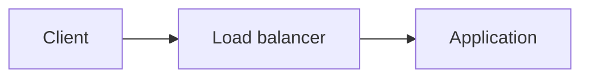

# Authoring guide

This guide explains how to add and maintain the repository content: pages, their metadata, shared content, examples, deployment guides, runtime pages, and changelog entries.

For the text itself, follow the [style guide](./style-guide.md). To check and submit your change, follow [CONTRIBUTING.md](../CONTRIBUTING.md).

## Add a page or guide

Create new content from the archetypes in [`archetypes/`](../archetypes/), which set the front matter and the structure of each kind of page. These examples create a guide, a documentation page, and an application runtime page:

```bash
hugo new content --kind guides guides/frameworks/my-framework.md
hugo new content doc/develop/my-feature.md
hugo new content --kind applications doc/deploy/applications/my-runtime.md
```

Store a guide in the section that matches its subject, and add it to the section index. Add the card of a guide in `guides/static-sites/` to [`content/shared/static-guides.md`](../content/shared/static-guides.md), which this index and the Static runtime pages include.

Archetypes set `draft: true`, so regular builds exclude unfinished pages. Preview drafts locally with `hugo server --buildDrafts`. When the page is ready to publish, remove the `draft` field instead of setting it to `false`.

## Set the front matter

Hugo front matter stores the metadata of a page. This project uses the following fields:

| Field           | Status      | Purpose                                                                                                 |
| --------------- | ----------- | ------------------------------------------------------------------------------------------------------- |
| `aliases`       | Optional    | Redirects paths that existed previously. Omit the `/developers` base path, for example `/doc/docker`    |
| `authors`       | Changelog   | Lists contributors with `name`, `link`, and `image` fields                                              |
| `date`          | Changelog   | Sets the publication date or date-time in [ISO 8601](https://en.wikipedia.org/wiki/ISO_8601) format     |
| `description`   | Recommended | Provides the description of the page for search results and search engines                              |
| `draft`         | Optional    | Excludes unfinished content from regular builds when set to `true`. Remove the field before publication |
| `excludeSearch` | Optional    | Excludes the page from the search index when set to `true`. Set it for changelog entries                |
| `keywords`      | Optional    | Lists search keywords                                                                                   |
| `linkTitle`     | Optional    | Sets a short sidebar label, usually the product name, and defaults to `title`                           |
| `tags`          | Changelog   | Lists lowercase product tags with consistent spelling                                                   |
| `title`         | Required    | Sets the page heading and search-oriented title. The generated HTML title adds the Clever Cloud name    |
| `type`          | Optional    | Selects a content layout and uses `docs` outside the changelog                                          |
| `weight`        | Optional    | Orders pages in the sidebar and defaults to `0`                                                         |

Write a descriptive `title`, for search engine optimization (SEO), that doesn't repeat `Clever Cloud`: the generated HTML title includes it. Keep `linkTitle` short, usually the product name, to fit in the sidebar.

Don't add `aliases` to a new page: use them only to preserve URLs that existed previously. The [Hugo front matter documentation](https://gohugo.io/content-management/front-matter/) describes the supported formats and the built-in fields.

## Move, merge, or remove a page

When a page moves to another URL, or when you merge its content into another page:

- Add the old URL to the `aliases` of the destination page, so that Hugo keeps serving a redirect
- Carry over every alias the removed page already declared: they must keep resolving
- Update internal links to target the new URL directly instead of relying on the redirect
- Check each redirect in the build output before committing

Updating the links matters most in the shared blocks of `content/shared/`, which many pages include.

## Use shortcodes and shared content

This documentation uses the [Hextra theme](https://imfing.github.io/hextra/), whose [shortcodes](https://imfing.github.io/hextra/docs/guide/shortcodes/) improve readability:

- [Asciinema](https://imfing.github.io/hextra/docs/guide/shortcodes/asciinema/), with ``, plays a terminal recording
- [Badges](https://imfing.github.io/hextra/docs/guide/shortcodes/others/#badge), with ``, mark the status of an element
- [Cards](https://imfing.github.io/hextra/docs/guide/shortcodes/cards/), with ``, link to related resources
- [Details](https://imfing.github.io/hextra/docs/guide/shortcodes/details/), with `{}`, fold optional content
- [File trees](https://imfing.github.io/hextra/docs/guide/shortcodes/filetree/), with ``, show the structure of a project
- [Galleries](https://imfing.github.io/hextra/docs/guide/shortcodes/gallery/), with `` and `` children, show several images
- Hero subtitles, with ``, introduce a guide
- [Steps](https://imfing.github.io/hextra/docs/guide/shortcodes/steps/), with `{}`, suit the `/guides/` section, or any tutorial
- [Tabs](https://imfing.github.io/hextra/docs/guide/shortcodes/tabs/), with `` and named `` children, show alternatives side by side

Use details for content only some readers need, such as a long log or a complete configuration file. The main path of the page then stays short. Store a terminal recording in `static/`. The Markdown output of a page, which large language models read, drops it: show the commands it plays in a code block too.

By default, tab blocks with the same names, in the same order, share their selection: choosing a tab in one selects it in the others. The browser remembers this choice. Name the tabs of similar blocks the same way, such as `npm`, `pnpm`, and `yarn`, in this order.

Hugo adds the `/developers` base path to Markdown links and images. A card's `link` and a figure's `src` keep their local paths as written: include the base path, such as `/developers/doc/deploy/applications/` in a card link.

The project adds its own shortcodes in [`layouts/shortcodes/`](../layouts/shortcodes/), such as `runtimes_versions` for the tables of versions. The [style guide](./style-guide.md#callouts) explains how to choose and write callouts.

### Diagrams

Draw a process or an architecture, such as the path of a request, with [Mermaid](https://mermaid.js.org/), in a code block of the `mermaid` language. The theme renders the diagram, and the Markdown output of the page keeps its code. Always explain in the text what the diagram shows: it illustrates the explanation, it doesn't replace it.

````markdown

````

### File trees

Show the structure of a project, such as where a runtime expects its files, with a file tree. Nest `filetree/folder` and `filetree/file` in a `filetree/container`, and add `state="closed"` to a folder to fold it:

```markdown

  
    
    
      
    
  

```

The Markdown output of the page turns the tree into a nested list.

### Icons

Cards, tabs, and the `` shortcode take the name of an icon from these sources:

- The [Heroicons](https://heroicons.com) the theme provides, such as `cube`
- The icons of the project in [`data/icons.yaml`](../data/icons.yaml), such as `docs-suite`
- [Simple Icons](https://simpleicons.org), for brands and products, with the `simple:` prefix, such as `simple:postgresql`

The Markdown output of a page drops its icons: don't let an icon carry information on its own.

### Shared content

When several pages need the same content, write it once in a page of [`content/shared/`](../content/shared/). Include it in each of them with the `include` shortcode of the theme, here for `content/shared/env-injection.md`:

```markdown
{}
```

Hugo never publishes this section: its pages only serve the pages that include them. A block that starts with a shortcode needs a front matter, even an empty one: otherwise, Hugo reads its `{{` as a JSON front matter. The headings of a shared block appear in the table of contents of these pages, and `hugo server` reloads them when the block changes.

### Images

Store documentation images under `static/images/`, and reference them with Markdown:

```markdown

```

When the image needs attributes, such as a width limit, use the Hugo [`figure` shortcode](https://gohugo.io/shortcodes/figure/), with the `/developers` base path in `src`:

```markdown

```

### Glossary terms

Add a term, its abbreviation, and its definition to [`data/en/termbase.yaml`](../data/en/termbase.yaml), then write it with the `term` shortcode of the theme, such as ``. The site shows the definition on hover, and the Markdown output writes it in parentheses.

### Product status

When a product is in beta or in private access, show its status the same way everywhere:

- A `> [!NOTE]` callout at the top of its page, such as `> [!NOTE] Clever KMS is in private access`
- The `tag` of every card that leads to this page, `Beta` or `Private access`
- A badge next to an element of a page, such as a table row or an option, when only this element has a status

Explain in the callout what the status implies, such as the data not to store or where to share feedback. The Markdown output of a page keeps the tags of cards and the text of badges.

### Source formatting

Keep each paragraph on one logical line, and rely on editor word wrap: don't hard-wrap prose with line breaks that don't affect rendering. End every text file with a newline character.

## Write commands and examples

Provide complete examples that run, with real commands and configurations. Add setup context and expected output when they help. Use realistic names instead of `foo`, `bar`, or `example`, and exact environment variable names, such as `CC_WEBROOT`.

Keep commands literally copyable. Don't use shell-invalid placeholders or bracketed optional arguments in executable code blocks: show optional variants separately, or explain where to add the flag. Archetypes are the exception: replace their placeholders, such as `<runtime>` or `RUNTIME`, before you publish the page.

Add code comments only when they explain non-obvious behavior.

Set the language of every code block, which markdownlint checks, such as `bash` for commands, `text` for their output, or the format of a file. When a block shows a file, give its name in `filename`. To link this name to the file in a repository, add the folder URL in `base_url`. Highlight the lines readers must change with `hl_lines`, as the [syntax highlighting](https://imfing.github.io/hextra/docs/guide/syntax-highlighting/) of the theme allows:

````markdown
```toml {filename="mise.toml",hl_lines=[2]}
[tools]
"github:Pagefind/pagefind" = "1.6.0"
```
````

## Configure dependencies

All non-Docker runtimes provide a shared set of tools and version-management variables, whatever the runtime of the application. For example, `CC_NODE_VERSION` can select Node.js in a PHP application, while `CC_PHP_VERSION` can select PHP in a Node.js application. Other shared tools include Composer, Gradle, Hugo, and Python.

Prefer these dedicated environment variables, and the package managers the runtime already provides, when they manage a dependency or its version. If a Mise task also needs a runtime-managed tool, derive its Mise version from the dedicated environment variable instead of hard-coding the same version twice.

For other deployment dependencies, prefer [Mise](https://mise.jdx.dev/) and a suitable backend, such as [HTTP](https://mise.jdx.dev/dev-tools/backends/http.html) or [GitHub](https://mise.jdx.dev/dev-tools/backends/github.html), over custom download scripts. Pin their versions whenever it's appropriate.

Don't document the deprecated `clevercloud/*.json` configuration files and fields when environment variables or the detection of the project replace them. Document them only when they have no alternative.

## Write a deployment guide

Prefer one clear path that uses platform defaults and native features. Follow every documented command from a fresh project, and test every behavior the guide promises. Verify the default build and run configuration before documenting any scaling override.

Write the Clever Tools commands the way recent guides do:

- Follow their option style, including short Clever Tools options where established
- Omit `-a` when the current directory is linked to only one application
- Use an application alias to disambiguate or link resources
- Place the standard `clever domain` and custom-domain example right after the application creation

When a guide needs a portable password-generation example and OpenSSL is already a prerequisite, use `openssl rand -base64 32`.

Check that the command output you capture in a guide doesn't expose credentials, tokens, add-on environment values, or unrelated account data. Validate public-storage claims with an unauthenticated request, and persistence claims after a restart or rebuild.

## Write a runtime page

The pages of `content/doc/deploy/applications/` describe how Clever Cloud builds and starts each runtime. Start from the `applications` [archetype](#add-a-page-or-guide), which sets their structure: overview, mandatory needs with a minimal application, build phase, version, caches, Clever Tasks, and Go Further cards.

Give a minimal application, with the command to try it locally when the ecosystem has one. When the application starts its own web server, it listens on `0.0.0.0` and on the port in `PORT`. When Clever Cloud starts the server, such as Puma for Ruby, explain it instead.

Show the commands the build runs, in their order, and the variables that change them. Deploy every example, and test every behavior the page describes, including the failures it warns about. Remove what you can't verify.

When Clever Cloud provides a list of versions, add it to [`data/runtime_versions.yml`](../data/runtime_versions.yml), and generate the table with the `runtimes_versions` shortcode, not by hand. Quote the versions in this file, so that YAML doesn't read `3.10` as `3.1`. When the project sets its version, such as a Stack snapshot, explain how instead.

Keep the headings deployment logs link to, such as *Manage your static files and assets* on the Ruby page: the link checker doesn't see them. Link related pages with cards in a *Go Further* section, not with shared content blocks.

## Add a changelog entry

Only Clever Cloud team members add entries to `content/changelog/`, one per significant platform update. To report an error, [open an issue](https://github.com/CleverCloud/documentation/issues). Keep entries concise, and focused on what users need to understand or act on.

Store each entry under its publication year, and name it with the `MM-DD-title.md` format, such as `content/changelog/2026/08-26-product-update.md`. Multiple entries can share the same date. Show complete command sequences, and commit the entry with the pages it relies on, as the [commit conventions](../CONTRIBUTING.md#commit-messages) explain.

A changelog entry can use the following front matter:

```yaml
---
title: Product 1.2 is available
description: Product 1.2 adds a new feature and fixes an upgrade issue
date: 2026-08-26
tags:
  - product
authors:
  - name: Clever Cloud
    link: https://github.com/CleverCloud
    image: https://github.com/CleverCloud.png?size=40
excludeSearch: true
---
```

## Update generated content

Don't edit the body of [`content/doc/cli-reference.md`](../content/doc/cli-reference.md) by hand. It comes from the documentation of a Clever Tools release, and this repository maintains only its front matter. Regenerate it from the latest release, or from the version you pass as argument, with:

```bash
scripts/update-cli-reference.sh
scripts/update-cli-reference.sh 5.3.0
```

The script keeps the front matter of the page.

## Change the theme and assets

- Don't override global styles for font type, size, or color
- Comment your code if you add custom CSS
- Import only the relevant classes from an external CSS tool, not the whole file
- Prefer self-hosting over a CDN, which can impact the performance of the site when used in `<head>`

A CDN remains fine for test purposes, when you submit your pull request and deploy a review app.
